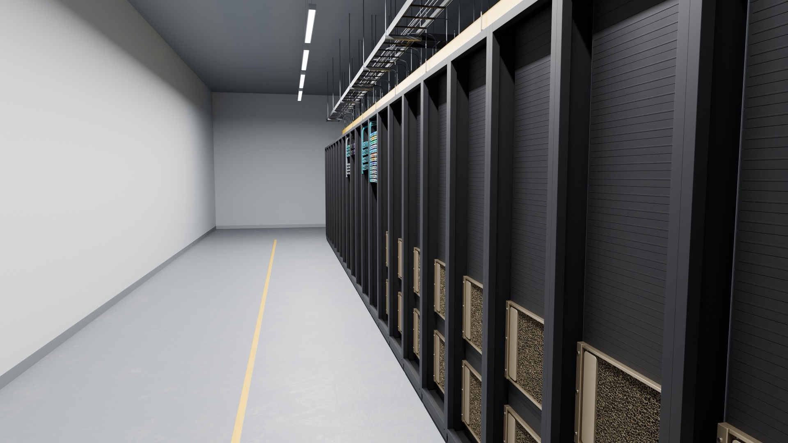
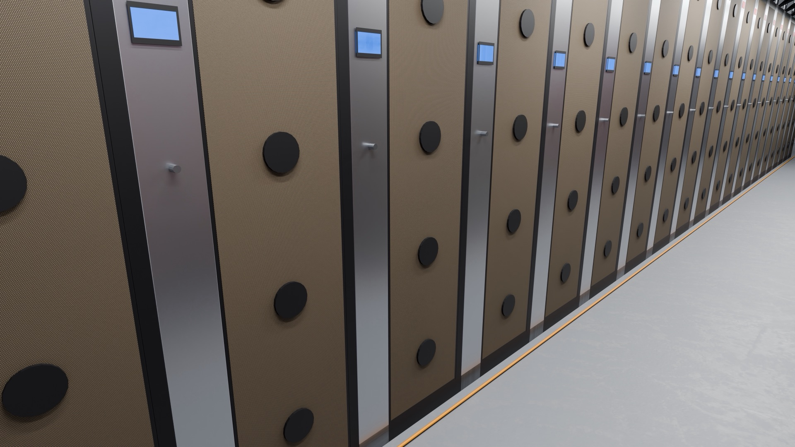
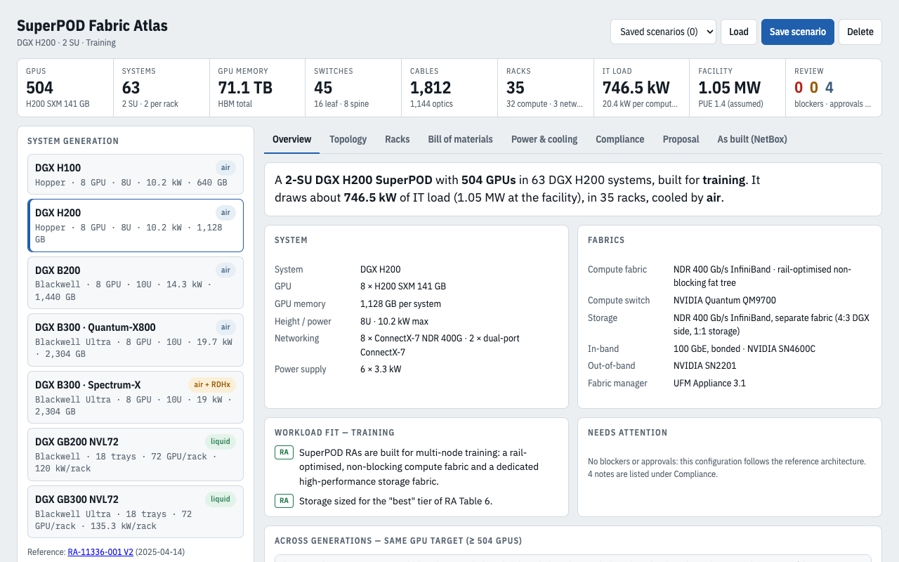

# DGX SuperPOD as code

A reference-faithful design of NVIDIA DGX SuperPODs, written as data and generated into everything
an architect needs to review or build from: a NetBox model, draw.io drawings, rack elevations, a
bill of materials, a cable map, an IP plan and photoreal 3D renders.



## The problem

Designing a 500-GPU-class SuperPOD from NVIDIA's reference architecture means getting several
interlocking things right at once, and keeping them right when a number changes:

- **Four networks.** A rail-optimised InfiniBand compute fabric (8 rails per node), a storage
  fabric, an in-band Ethernet network and a 1 GbE out-of-band network, each with its own switch
  counts, oversubscription rules and cable types.
- **Power.** Three discrete power paths per rack, rPDU-to-PSU mapping, per-rack budgets against
  the reference circuit sizes.
- **Cooling.** Hot-aisle containment for air-cooled H200, rear-door heat exchangers and direct
  liquid for GB300 NVL72, with CDUs and a plant.
- **Racks and hall.** Rack-unit placement, rack counts, aisle widths and cable paths.

A spreadsheet drifts. A drawing goes stale. This repo derives all of them from one source.

## Approach

```
spec/*.yaml  ->  topology generator (src/dgxnb)  ->  NetBox (source of truth, optional)
                                                 ->  draw.io pages, rack elevations
                                                 ->  BOM, cable map, IP plan, NVIDIA Air topology
                                                 ->  scene.json  ->  Blender renders
```

- The **spec** holds the choices (SU count, GPU generation, storage tiers, power, hall layout).
  Every sizing number cites its section of the reference architecture in `docs/ra-notes*.md`;
  every judgement call is labelled CHOICE with its reason in `docs/design-choices.md`.
- The **generator** is a pure function from spec to a desired-state model, tested offline.
- A **reconciler** applies that model to a NetBox instance idempotently by natural key, and prunes
  only what it owns. NetBox is optional: every output below is generated without it.
- Unsourced values are listed, with what was used and where to look, in `docs/not-found.md`.

## What the model enforces

The offline tests (`tests/`) and the live validator (`bin/validate`, needs a NetBox) check, among
others:

- node, GPU, switch and rack counts equal the reference architecture's scale tables (1 to 4 SUs);
- every DGX has 8 compute cables to 8 distinct leaf switches, one per rail, and each leaf serves
  one rail only;
- no leaf has more downlinks than uplinks (non-blocking fat tree);
- every cable has two terminations and no port is cabled twice;
- every DGX PSU lands on a free outlet of the right type, two PSUs per rPDU, three power paths;
- peak draw per rack stays inside its budget;
- no two devices overlap in a rack, and nothing exceeds the rack height;
- the generated output is deterministic.

## The three designs

| Design | Spec | Compute | Racks | Cables |
|---|---|---|---|---|
| 2-SU DGX H200 (reference architecture RA-11336-001) | `spec/superpod.yaml` | 63 DGX H200 = 504 GPUs | 38 | 2,445 |
| 1-SU DGX GB300 NVL72 | `spec/gb300-su.yaml` | 8 NVL72 racks, 144 trays = 576 GPUs | 12 | 3,876 |
| Mixed liquid pod: 1 SU H200 with rear-door heat exchangers + 1 SU GB300 on direct liquid, one cooling plant | `spec/superpod-mixed.yaml` | 31 DGX + 144 trays = 824 GPUs | 33 | 5,310 |

The generator's cable count includes the power cords (about 620 for the H200 design) and the
storage and management cabling it models in full; the Fabric Atlas counts a narrower scope, data
cables only (compute, storage, in-band, out-of-band) without power cords, from its own sizing
rules. For the same 2-SU H200 the Atlas reports 1,812 cables and 35 racks against the generator's
2,445 and 38, so the numbers differ by design.

Outputs for the H200 design are in `docs/`; the other two are in `docs/dgx-gb300-su/` and
`docs/dgx-superpod-mixed/`. Each has a draw.io file (open in diagrams.net), a cable map CSV, a BOM,
an IP plan and an NVIDIA Air topology.



## Fabric Atlas

A single-file configurator for DGX SuperPODs from H100 to GB300: pick generation, cooling, SU
count and workload, and get live GPU, switch, cable, rack and power counters, topology, rack
elevations and a BOM where each line is tagged RA, DERIVED, CHOICE or NON-RA. It runs entirely in
the browser; saved scenarios use local storage.



Build it with `python3 viewer/atlas/build.py` (output: `viewer/dist/fabric-atlas.html`).

## Run it offline

```bash
uv run pytest                              # generator tests (no NetBox needed)
node --test viewer/atlas/test.mjs          # Atlas engine reproduces the RA scale tables
bin/dgxnb export                           # H200: cable map, BOM, IP plan, draw.io, scene.json
bin/dgxnb export --spec spec/gb300-su.yaml
bin/dgxnb export --spec spec/superpod-mixed.yaml
python3 viewer/atlas/build.py              # Fabric Atlas
```

Python 3.9+ with [uv](https://docs.astral.sh/uv/). To apply a design to your own NetBox, set
`NETBOX_URL` and `NETBOX_TOKEN` and run `bin/dgxnb plan` (a read-only diff) before
`bin/dgxnb apply`. The Blender pipeline is described in `blender/README.md`.

## Design choices

Every place the reference architecture is silent or ambiguous is recorded with the options and the
reason for the pick in [`docs/design-choices.md`](docs/design-choices.md). For example: the
rack-unit layout of rPDUs, the tier-1 storage count and its documented alternative, and the
training-first workload assumption.

## What this is not

- Not an NVIDIA product, and not endorsed by NVIDIA.
- Not a validated deployment. It is a design exercise that follows the public reference
  architecture closely; where it had to choose, it says so.
- Not a pricing tool. The BOM counts parts; it does not price them.
- Device-type files for third-party gear are community library definitions or labelled stand-ins;
  `docs/not-found.md` lists every unsourced value.

Built with Claude Code as a pair programmer; the design choices and review are mine.

## Licence

Code: MIT (`LICENSE`). Documentation and renders: CC BY 4.0 (`docs/LICENSE-docs`). See `NOTICE`.
